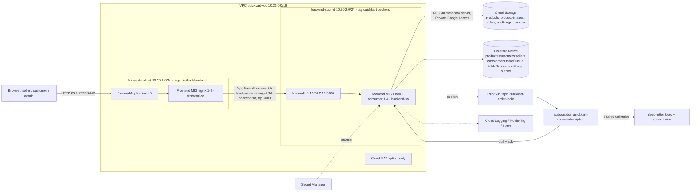

# QuickKart on Google Cloud (GCP) - Phase 2
Seller publishing -> customer COD ordering -> Pub/Sub processing -> Firestore tables -> delivery -> Cloud Storage archive, on Compute Engine MIGs behind load balancers, secured with a service account, IAM, VPC firewall rules and Terraform.
This is the GCP port of the Azure project (same UI and REST API). Read `docs/GAP-ANALYSIS.md` first, then `docs/DEMO-GUIDE.md`.

## Quick start
```bash
gcloud auth login && gcloud config set project <PROJECT_ID>        # Cloud Shell: already done
cd scripts && ./deploy.sh              # APIs + terraform init/validate/plan/apply, ~15 min, prints URL + credentials
python3 e2e_test.py --url http://<LB_IP>      # acceptance tests 1-26 + extras
./test-infra.sh                        # tests 27-30 (IAM, firewall, autoscaling, logging)
./cleanup.sh                           # terraform destroy (stops billing)
python3 e2e_test.py --local            # offline logic check with in-memory fakes (no GCP needed)
```
Windows Git Bash: use Cloud Shell if `gcloud`/`terraform` are blocked by your organisation.

## Architecture


## Azure -> GCP mapping
| Azure (Phase 1) | GCP |
|---|---|
| Blob Storage | Cloud Storage (private bucket, folders) + Firestore |
| Storage Queue | Pub/Sub topic + pull subscription + dead-letter topic |
| Table Storage (TableQueue/TableService) | Firestore collections `tableQueue`, `tableService` |
| Managed Identity + RBAC | Attached service account + ADC + IAM roles |
| NSG + ASG | VPC firewall rules + network tags / service-account targeting |
| VMSS + autoscale | Instance templates + regional MIGs + autoscalers |
| Public/Internal LB | External Application LB / Internal passthrough LB |
| Private Endpoint + DNS | Private Google Access (+ Private Service Connect optional) |
| Azure Monitor | Cloud Logging + Monitoring + alert policies |
| Bicep | Terraform |

## Data responsibilities
| Store | Holds |
|---|---|
| **Firestore** (source of truth) | products, customers, sellers, carts, orders, tableQueue, tableService, auditLogs, outbox |
| **Cloud Storage** | `product-images/`, `products/<id>.json`, `orders/<id>.json` (archive), `audit-logs/<event>/...`, `backups/` |
| **Pub/Sub** | order events (at-least-once delivery) |
Firestore, Pub/Sub and Cloud Storage are separate systems: **no cross-service transaction**. Order + stock + tableQueue + tableService + outbox are one Firestore transaction; Pub/Sub publishing uses the outbox + retry; GCS copies use a `gcsSyncPending` flag + reconcile; the consumer is idempotent.

## Project structure
```
backend/   app.py config.py worker.py  routes/{auth,products,cart,orders,admin,storage}.py
           services/{firestore,storage,pubsub,audit,auth,identity,product,order,queue_worker}_service.py  models/{product,order}.py
frontend/  index products cart checkout orders login seller admin storage-dashboard (.html) css js
infrastructure/terraform/  providers variables main networking firewall storage firestore pubsub iam compute load-balancer monitoring outputs (.tf) + startup-*.sh.tpl
scripts/   env setup-gcp deploy update-app iam-demo test-storage test-pubsub test-infra load-test cleanup (.sh) e2e_test.py
tests/     fake_gcp.py
docs/      GAP-ANALYSIS ARCHITECTURE DEPLOYMENT IAM-GUIDE NETWORKING-GUIDE STORAGE-GUIDE DEMO-GUIDE TROUBLESHOOTING API TEST-REPORT CHANGES
```
Roles: `seller` (own products), `customer`, `admin` (delivery operator). Demo users are seeded; passwords are random, stored in Secret Manager, printed by `deploy.sh`.

## Prerequisites
GCP project with billing; `gcloud` >= 450, `terraform` >= 1.5, `python3`; permissions to create resources (Owner on a sandbox project is simplest). Terraform on your PC also needs `gcloud auth application-default login`.

## Cost (approx., asia-south1, running 24x7)
4 x e2-medium (~$1.2/day each), global external LB rules (~$0.6/day) + ILB, Cloud NAT (~$1.3/day + data), Firestore/Pub/Sub/Storage (cents for the demo), Cloud Logging/Monitoring (free tier covers the demo). Roughly **$6-9/day**. Run `./cleanup.sh` after class. Check the Pricing Calculator for current prices.

## Docs index
`docs/DEPLOYMENT.md` (env vars, Terraform, rollback), `IAM-GUIDE.md`, `NETWORKING-GUIDE.md`, `STORAGE-GUIDE.md` (GCS, Firestore, Pub/Sub), `API.md`, `TROUBLESHOOTING.md`, `TEST-REPORT.md`, `CHANGES.md`.
